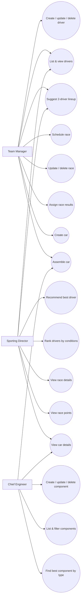
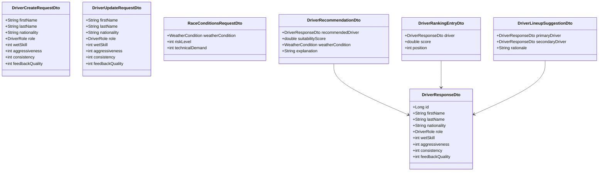
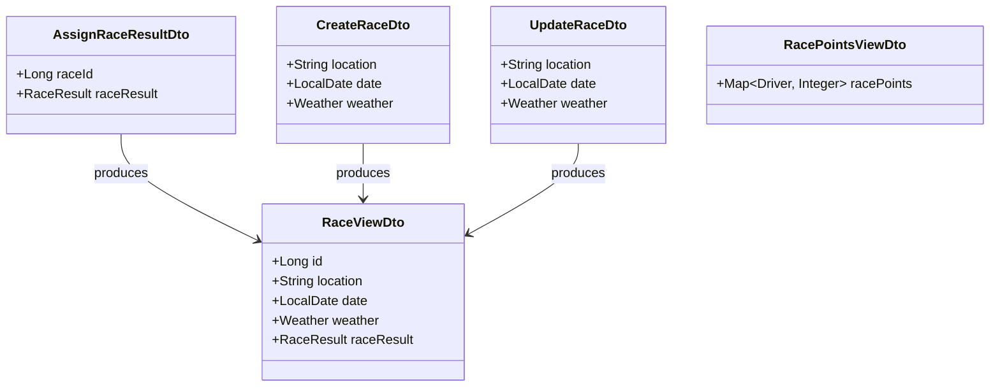
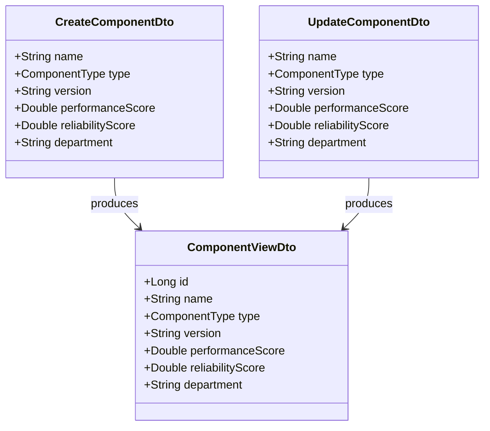
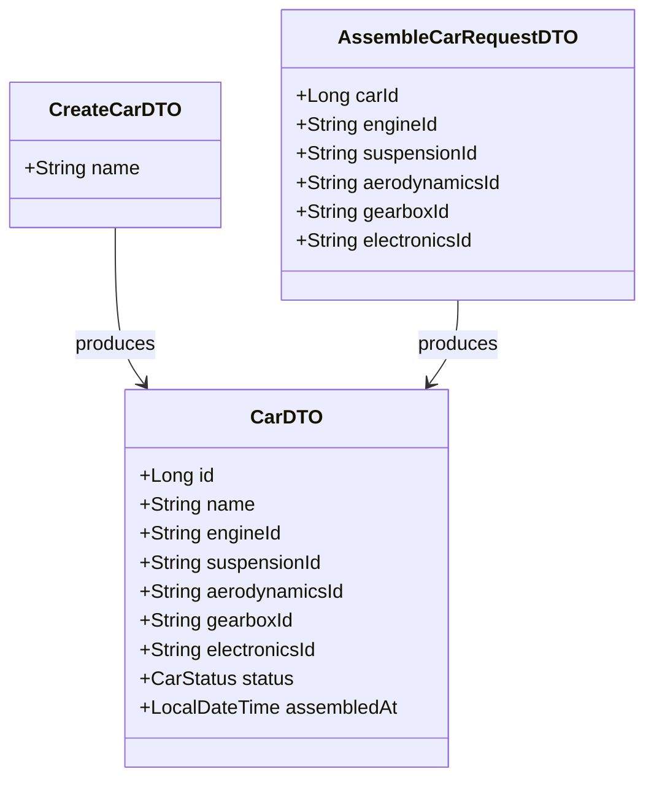

# Formula One Team Management System

## Project Description

This project implements a microservice-based system for managing a Formula 1 team's championship participation and
internal engineering workflow.

The system models:

- a roster of drivers (main, test, reserve) with performance characteristics,
- race scheduling, results recording, and points calculation,
- car assembly from individual components,
- component inventory with performance and reliability tracking,
- modular service architecture.

**Persistence (Milestone 2):** Services that own domain data use Spring Data JPA. The default configuration uses an
in-memory **H2** database per service (suitable for development and CI). REST APIs are wired through the service layer
to repositories.

**Asynchronous messaging (Milestone 2):** **car-service** publishes a JSON event to an Apache **Artemis** queue when a
car is successfully assembled. **component-service** consumes that message asynchronously and stores an audit row in
its database (message id, payload, timestamps). Queue names and listener settings are configurable via `application.yml`.

---

## Microservices

### `driver-service`

Standalone Spring Boot service for driver-related operations:

- CRUD over drivers,
- recommendation of best driver for race conditions,
- ranking drivers by suitability score for given conditions,
- suggesting a two-driver race lineup for the team's two cars.

Uses JMS with an **embedded** Artemis broker by default (see `driver-service` `application.yml`).

### `race-service`

Standalone Spring Boot service for race scheduling and results management:

- CRUD over scheduled races (location, date, weather),
- assigning official finishing results to a completed race,
- calculating and retrieving championship points per race.

### `component-service`

Standalone Spring Boot service for managing F1 car components:

- CRUD over components (engine, suspension, aerodynamics, gearbox, electronics),
- filtering components by type, department, or both,
- retrieving the best-performing component for a given type,
- consuming **car assembly completed** events from Artemis and persisting them for auditing.

### `car-service`

Standalone Spring Boot service for managing F1 cars:

- creating cars (initially without components),
- assembling a car by assigning one unique component per slot (engine, suspension, aerodynamics, gearbox, electronics),
- retrieving car details and assembly status,
- publishing **car assembly completed** messages to Artemis after a successful assembly.

---

## Apache ActiveMQ Artemis

**car-service** and **component-service** use Artemis in **native** client mode: they connect to a broker over TCP.
**driver-service** does not require an external broker for its default configuration.

Default URL and credentials (see `car-service` / `component-service` `application.yml`):

| Setting | Value |
|--------|--------|
| Broker URL | `tcp://localhost:61616` |
| User | `admin` |
| Password | `admin` |

JMS settings are under `spring.artemis` and service-specific queue names under `car-service.jms` /
`component-service.jms`.

### Run Artemis with Docker or Podman

The official image is [`apache/artemis`](https://hub.docker.com/r/apache/artemis). Use **alpine** tags for a smaller
image.

**Docker:**

```bash
docker run --detach --name artemis \
  -p 61616:61616 \
  -p 8161:8161 \
  -e ARTEMIS_USER=admin \
  -e ARTEMIS_PASSWORD=admin \
  apache/activemq-artemis:latest
```

**Podman:**

```bash
podman run --detach --name artemis \
  -p 61616:61616 \
  -p 8161:8161 \
  -e ARTEMIS_USER=admin \
  -e ARTEMIS_PASSWORD=admin \
  docker.io/apache/activemq-artemis:latest
```

- **61616** — Core protocol (used by Spring JMS).
- **8161** — Web console: open [http://localhost:8161](http://localhost:8161) and sign in with the same user/password.

Stop and remove the container when finished:

```bash
docker stop artemis && docker rm artemis
# or: podman stop artemis && podman rm artemis
```

If you omit `ARTEMIS_USER` / `ARTEMIS_PASSWORD`, the image defaults to user **`artemis`** / password **`artemis`**; in
that case either update both services' `application.yml` to match or always pass the environment variables as above.

### Artemis and Docker Compose

`docker-compose.yml` in this folder defines an **`artemis`** service and sets `SPRING_ARTEMIS_BROKER_URL=tcp://artemis:61616`
for **car-service** and **component-service** so they reach the broker on the compose network. Start the stack from the
`formula-one-team` directory:

```bash
docker compose up --build
```

---

## Showcase Scenario: Race Weekend Command Center

The repository contains a runnable Locust scenario in [`showcase/locustfile.py`](showcase/locustfile.py). It models a
race-weekend command center where several users read operational data at the same time:

- **Chief engineers** repeatedly inspect the component inventory and request the best component by type.
- **Sporting directors** monitor drivers and scheduled races.
- **Garage crew** checks the current car list before assembly decisions.
- **Operators** poll Prometheus metrics to confirm that the services stay observable during the load.

The scenario intentionally gives the highest weight to **component-service** traffic. This represents a peak period
before a race when engineers are repeatedly comparing available parts and selecting the best component configuration.

### Goal

Showcase that the system can serve concurrent read traffic across all services while component-service receives the
largest share of requests. During a successful run:

- protected API requests should return HTTP `200` when a bearer token with `test_read` scope is provided,
- Prometheus metrics requests should return HTTP `200` without authentication,
- component-service should have the highest request count in Locust statistics,
- response times and failures should remain visible in Locust, Prometheus, and Grafana.

If no bearer token is provided, Locust still starts, but protected API calls are expected to fail with `401` or `403`.
Set `F1_ACCESS_TOKEN` to run the full scenario.

### Run the Scenario

Start the system:

```bash
cd formula-one-team
docker compose up --build
```

Install Locust in a local virtual environment:

```bash
python3 -m venv .venv-showcase
source .venv-showcase/bin/activate
pip install -r showcase/requirements.txt
```

Run Locust with the web UI:

```bash
export F1_ACCESS_TOKEN="<access-token-with-test_read-scope>"
locust -f showcase/locustfile.py --web-host 127.0.0.1
```

Open [http://localhost:8089](http://localhost:8089), choose a user count such as `25`, a spawn rate such as `5`, and
start the test. The default service URLs are:

| Service | Default URL |
|---------|-------------|
| driver-service | `http://localhost:8080` |
| component-service | `http://localhost:8081` |
| race-service | `http://localhost:8082` |
| car-service | `http://localhost:8083` |

Override them when needed:

```bash
DRIVER_SERVICE_URL=http://localhost:8080 \
COMPONENT_SERVICE_URL=http://localhost:8081 \
RACE_SERVICE_URL=http://localhost:8082 \
CAR_SERVICE_URL=http://localhost:8083 \
locust -f showcase/locustfile.py
```

For a repeatable headless run:

```bash
mkdir -p showcase-results
locust -f showcase/locustfile.py \
  --headless \
  --users 25 \
  --spawn-rate 5 \
  --run-time 3m \
  --csv showcase-results/race-weekend
```

Expected result: Locust should report successful `200` responses for the protected read endpoints when
`F1_ACCESS_TOKEN` is valid. The busiest endpoints should be `component-service: list components` and
`component-service: best component by type`, demonstrating the intended engineering peak load.

---

## Use Case Diagram (at least 2 roles)



---

## DTO Class Diagram

### `driver-service`



### `race-service`



### `component-service`



### `car-service`



---

## Executable Maven Modules

- `driver-service`
- `race-service`
- `component-service`
- `car-service`

---

## Build and Run

From the `formula-one-team` directory:

```bash
mvn clean install
```

### Run microservices locally (Maven)

1. Start **Artemis** (see [Apache ActiveMQ Artemis](#apache-activemq-artemis)).
2. In separate terminals, start each service (API base paths use `/api/v1` where applicable):

```bash
cd driver-service && mvn spring-boot:run      # http://localhost:8080
cd race-service && mvn spring-boot:run        # http://localhost:8082
cd component-service && mvn spring-boot:run     # http://localhost:8081/api/v1
cd car-service && mvn spring-boot:run         # http://localhost:8083/api/v1
```

Paths are relative to the `formula-one-team` module root.

### Run with Docker Compose

From `formula-one-team`:

```bash
docker compose up --build
```

This starts Artemis and all four services. The web console is at [http://localhost:8161](http://localhost:8161).

If you use Podman with Compose support, run the same from this directory: `podman compose up --build`.

---

## OpenAPI / Swagger

When services are running locally:

- `driver-service` — Swagger UI: `http://localhost:8080/swagger-ui/index.html`
- `component-service` — Swagger UI: `http://localhost:8081/swagger-ui.html`
- `race-service` — Swagger UI: `http://localhost:8082/api/v1/swagger-ui.html`
- `car-service` — Swagger UI: `http://localhost:8083/api/v1/swagger-ui.html`

---

## Security (OAuth2)

All `/api/**` endpoints require a valid JWT issued by the MUNI OIDC provider (`https://id.muni.cz/oidc/`).

| Scope | Grants access to |
|-------|-----------------|
| `test_read` | All GET endpoints |
| `test_write` | POST, PUT, DELETE endpoints |

Requests without a token receive `401 Unauthorized`. Requests with a token that lacks the required scope receive `403 Forbidden`.

**Getting a token:**

1. Run the PA165 seminar OAuth2 client (port 8090).
2. Open `http://localhost:8090/swagger-ui.html` and click **Authorize**.
3. Log in with your MUNI credentials, approve `openid test_read test_write` scopes.
4. Copy the `access_token` from DevTools → Network → the token response.

**Using the token (curl):**

```bash
curl -H "Authorization: Bearer <token>" http://localhost:8080/api/v1/drivers
```

**Using the token (Swagger UI):** Open the service's Swagger UI, click **Authorize**, paste the raw token under the `BearerAuth` scheme, and click **Authorize**. Do not include the `Bearer ` prefix; Swagger UI adds it automatically.

---

## Observability

Prometheus and Grafana are included in `docker-compose.yml` and start automatically with `docker compose up`.

| Tool | URL | Credentials |
|------|-----|-------------|
| Prometheus | http://localhost:9090 | — |
| Grafana | http://localhost:3000 | admin / admin |

Prometheus scrapes `/actuator/prometheus` from driver-service and component-service, and `/api/v1/actuator/prometheus` from race-service and car-service because those two services run under the `/api/v1` servlet context. Grafana is pre-provisioned with a dashboard showing service health, JVM memory, HTTP request rates, and active DB connections. No manual configuration is required.

---

## Showcase Scenario — Race Day Driver Selection & Telemetry

This scenario walks through a team manager's workflow: evaluating the driver lineup for a wet race, then ingesting and processing post-race telemetry.

All commands require a valid Bearer token (see [Security](#security-oauth2)).

**1. Get the full driver roster**
```bash
curl -H "Authorization: Bearer <token>" http://localhost:8080/api/v1/drivers
```

**2. Recommend the best driver for wet conditions**
```bash
curl -X POST -H "Authorization: Bearer <token>" -H "Content-Type: application/json" \
  -d '{"weatherCondition":"WET","riskLevel":75,"technicalDemand":80}' \
  http://localhost:8080/api/v1/drivers/recommendation
```
Expected: top driver with suitability score and explanation.

**3. Rank all drivers for comparison**
```bash
curl -X POST -H "Authorization: Bearer <token>" -H "Content-Type: application/json" \
  -d '{"weatherCondition":"WET","riskLevel":75,"technicalDemand":80}' \
  http://localhost:8080/api/v1/drivers/rankings
```

**4. Get a two-driver lineup suggestion**
```bash
curl -X POST -H "Authorization: Bearer <token>" -H "Content-Type: application/json" \
  -d '{"weatherCondition":"WET","riskLevel":75,"technicalDemand":80}' \
  http://localhost:8080/api/v1/drivers/lineup-suggestions
```
Expected: primary and secondary driver with rationale.

**5. Ingest post-race telemetry**
```bash
curl -X POST -H "Authorization: Bearer <token>" -H "Content-Type: application/json" \
  -d '{
    "driverId": 1, "raceId": 1,
    "readings": [
      {"fuelLevel": 85.5, "engineTemp": 92.1, "tirePressure": 24.3, "lapTime": 83.456},
      {"fuelLevel": 84.2, "engineTemp": 93.5, "tirePressure": 24.1, "lapTime": 83.210},
      {"fuelLevel": 83.0, "engineTemp": 94.0, "tirePressure": 23.9, "lapTime": 83.678}
    ]
  }' http://localhost:8080/api/v1/telemetry
```

**6. Trigger batch processing**
```bash
curl -X POST -H "Authorization: Bearer <token>" http://localhost:8080/api/v1/telemetry/process
```
Expected: `{"status":"COMPLETED","jobExecutionId":1}`

**7. Review aggregated race stats**
```bash
curl -H "Authorization: Bearer <token>" http://localhost:8080/api/v1/telemetry/drivers/1/stats
```
Expected: average fuel level, engine temp, tire pressure, lap time, and derived consistency score for the driver.

---

## CI/CD Pipeline

A GitLab CI pipeline (`.gitlab-ci.yml` at repository root) runs on every push:

| Stage | What it does |
|-------|-------------|
| `build` | Compiles all services, packages JARs (`-DskipTests`) |
| `test` | Runs the full test suite, publishes JUnit XML reports |

Test results appear in GitLab under **CI/CD → Pipelines → (job) → Tests**.

---

## GenAI Usage

GenAI was used as development support for:

- drafting initial service/module skeletons,
- generating technical documentation.

All generated output was reviewed and adjusted before integration.
